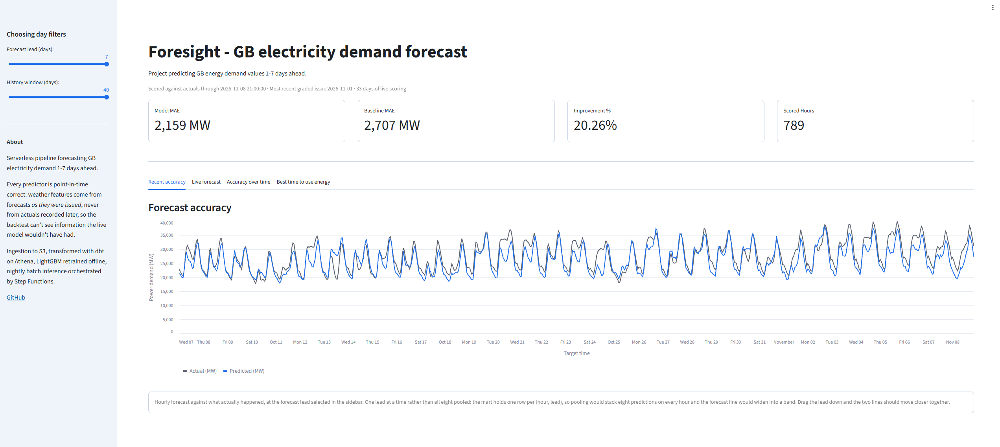
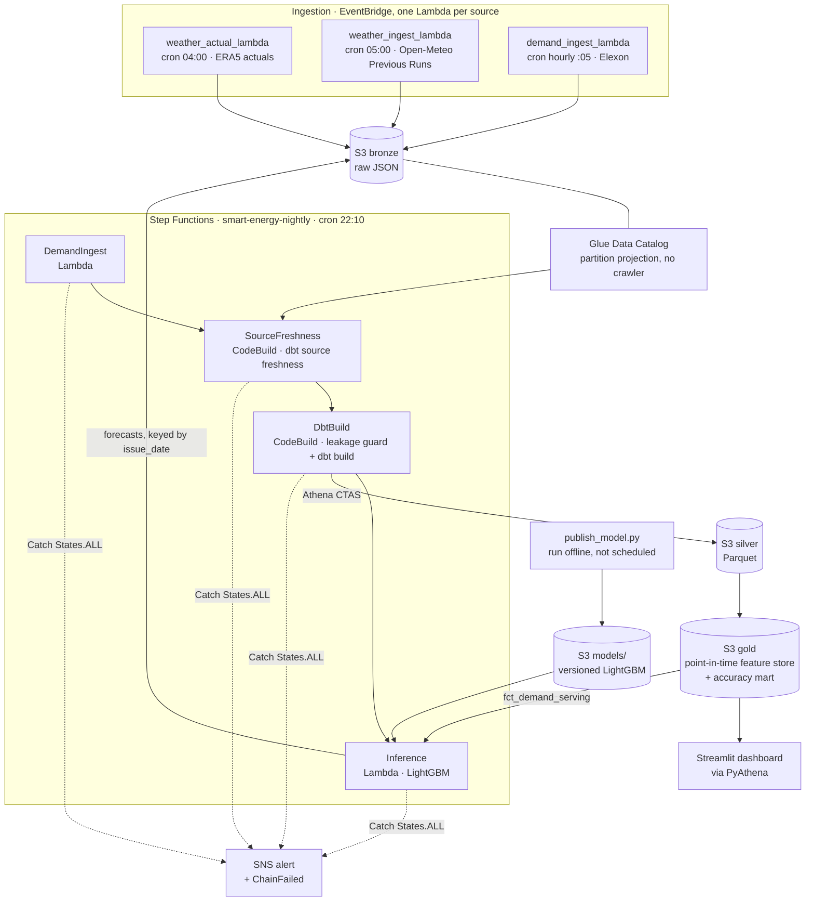
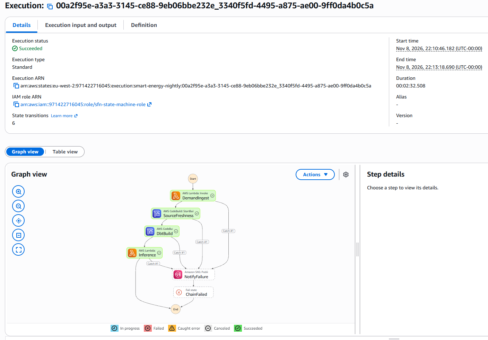
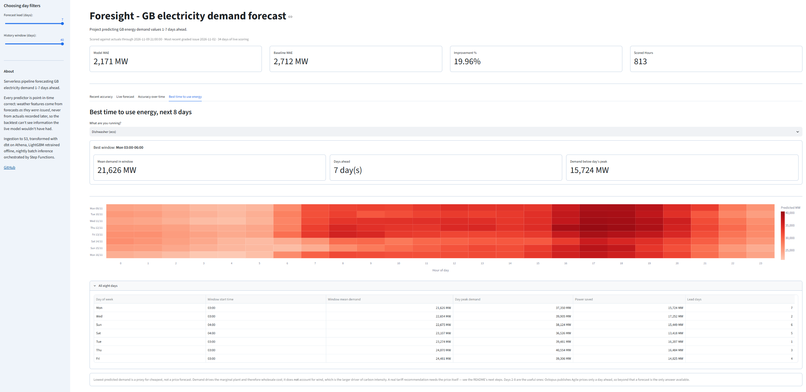
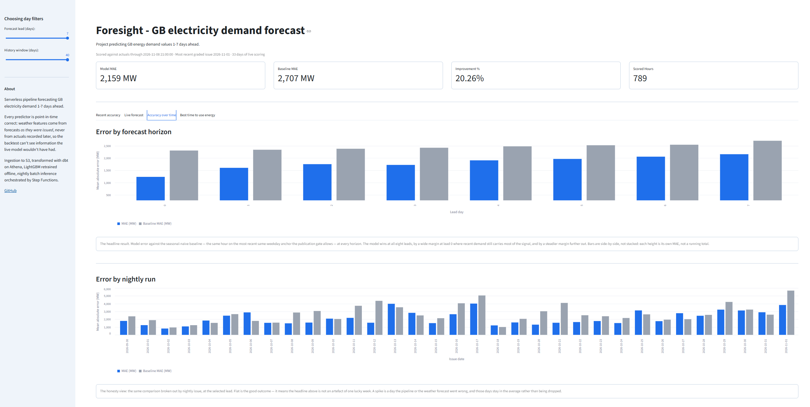

# Multi-Day GB Energy Demand Forecasting

> A serverless, point-in-time-correct forecasting pipeline on AWS. Ingests live GB electricity demand and issued weather forecasts; builds a leakage-safe feature store; trains and walk-forward-validates a demand forecaster; and tracks forecast accuracy against reality as it arrives.



---

## What this is

Foresight forecasts GB electricity demand **1–7 days ahead** — at the horizon where no official forecast is yet published, so the prediction is a genuine unknown rather than a copy of someone else's answer. Demand is driven by weather, the calendar, and human behaviour, which makes this an honestly hard forecasting problem with a clean way to measure success: wait, and reality tells you exactly how good each forecast was.

The project is built to demonstrate **data-engineering judgement**, not just model accuracy. The interesting parts are the point-in-time-correct feature store (no peeking at the future) and the deliberate, defensible AWS service choices — including the services I *didn't* use.

Current results: the model beats a seasonal-naive baseline by **27–48%** at every horizon under walk-forward validation. See [Results](#results).

The dashboard above reports a smaller figure — around 20% at lead 7 — and the gap is a difference of measurement, not of result. The table below is **RMSE** across 14 monthly backtest folds, roughly 20,000 scored hours per lead. The dashboard is **MAE** over the live nightly runs, a few hundred hours so far. Different metric, different sample, and the live number is the one still settling; both are reported rather than whichever flatters.

---

## Architecture



Two things the picture is really about. **The loop:** `Inference` writes its forecast back into bronze keyed by `issue_date`, where it sits untouched until the actuals arrive days later and `fct_forecast_accuracy` scores the two against each other — which is what makes the accuracy numbers unfakeable by construction rather than by promise.

**The guard:** `DbtBuild` runs `dbt ls --select +fct_demand_features` and fails if `stg_weather_actual` appears anywhere upstream. Weather *actuals* are ingested deliberately — they are how forecast-magnitude error was separated from forecast-bias error — but they must never reach a predictor. Asserting that on the dbt DAG rather than on column names means it survives renames and catches laundering through any number of intermediate models.

Training is deliberately outside the loop: a nightly chain that can retrain itself can also silently promote a worse model.



A nightly execution of `smart-energy-nightly`, start to finish in 2m 32s. The chain is
sequential deliberately: `SourceFreshness` refuses to build on stale inputs, and
`Inference` runs only after the marts it reads have been rebuilt.

Every state also carries a `Catch` into a single `NotifyFailure` SNS publish and a
`ChainFailed` terminal state, so a failure anywhere emails me rather than passing
silently — which matters more than it sounds, because the two worst bugs this project
hit both reported SUCCESS while doing nothing. Both are written up in
[What I'd do next](#what-id-do-next).

---

## Key design decisions

| Decision | Choice | Why |
|---|---|---|
| Ingestion | Lambda + EventBridge | Small, frequent API pulls; serverless, scales to zero |
| Storage | S3 + partitioned Parquet | Cheap, columnar, queryable by Athena |
| Query | Glue Catalog + Athena | Serverless SQL, pay-per-scan, no idle cost (not Redshift — data is small) |
| Transform | dbt-athena | Tests + lineage; builds the feature store |
| ML serving | **Scheduled batch inference, not a live endpoint** | Forecasts are generated on a schedule, not on demand — an always-on endpoint would be cost for no benefit |
| Orchestration | Step Functions + EventBridge | AWS-native, serverless |
| Streaming | None | Data is half-hourly batch; streaming would be unjustified here |
| IaC | Terraform | All infra as code, with teardown discipline |

**The point-in-time problem (the core of the project):** at prediction time you only have a weather *forecast*, never tomorrow's actual weather. Every predictor feature therefore uses forecasts *as they were issued* (via Open-Meteo's Previous Runs API, at 1–7 day lead offsets), never reanalysis actuals. Training on actuals is the most common way to accidentally cheat at energy forecasting — it looks brilliant in backtest and fails in production. Avoiding it is the whole game.

---

## Data sources

All open, no paid access required.

**In the pipeline today:**

- **GB electricity demand** — NESO / Elexon Insights (half-hourly)
- **Weather forecasts (predictors)** — Open-Meteo Previous Runs API (forecast-as-issued, 1–7 day lead offsets)
- **Weather actuals (targets)** — Open-Meteo Historical Forecast / ERA5
- **Calendar** — UK bank holidays (gov.uk)

**Planned, not built** (see [What I'd do next](#what-id-do-next)):

- **Carbon intensity** — Carbon Intensity API (api.carbonintensity.org.uk)
- **Agile prices** — Octopus Energy public API

<!-- TODO: confirm exact endpoints/params you settled on and link them here -->

---

## Repository structure

```
foresight/
├── infra/              # Terraform (module per AWS service)
├── ingestion/          # Lambda handlers, one per source
├── dbt/                # Silver + Gold (feature store) models
├── ml/                 # training, walk-forward backtest, batch inference
├── orchestration/      # Step Functions + EventBridge definitions
├── dashboard/          # Streamlit app
├── docs/               # architecture diagram, teardown runbook
└── README.md
```

---

## Getting started

> **Prerequisites:** an AWS account, Terraform ≥ 1.10 (AWS provider ~> 5.92), Python 3.12, and AWS credentials configured via `~/.aws/credentials`.

> ⚠️ **Cost first.** Set a billing alarm before provisioning anything. This stack is serverless by design and costs a few £/month with disciplined teardown, but always `terraform destroy` when you're not actively working.

```bash
# 1. Provision infrastructure
cd infra
terraform init
terraform apply

# 2. Run the nightly chain on demand
#    (it also runs itself at 22:10 UTC via EventBridge)
aws stepfunctions start-execution   --state-machine-arn "$(aws stepfunctions list-state-machines       --query "stateMachines[?name=='smart-energy-nightly'].stateMachineArn" --output text)"   --region eu-west-2

# 3. View the dashboard
pip install -r requirements-dashboard.txt
streamlit run dashboard/app.py

# 4. Tear down when done
terraform destroy
```

<!-- TODO: flesh out each step with real commands once built. See docs/TEARDOWN.md for full teardown. -->

---

## The dashboard

`streamlit run dashboard/app.py`. Four tabs, reading `gold.fct_forecast_accuracy` and
`silver.stg_inference_forecasts` directly through Athena.

A KPI row above the tabs shows, at the selected lead: model MAE, baseline MAE, the
improvement, and how many hours have been scored — all from a single query, so the four
numbers cannot disagree with each other.

| tab | what it answers |
|---|---|
| **Recent accuracy** | Hour by hour, how close was the forecast at this lead? |
| **Live forecast** | The current nightly issue, with recent actuals joined on, so the handoff from measured to predicted is visible in one line. |
| **Accuracy over time** | Error by horizon and by nightly run, each against the seasonal-naive baseline. The honesty view: a flat series means the headline is not one lucky week. |
| **Best time to use energy** | The lowest-predicted-demand window on each of the next 8 days — the practical output of the forecast. |



The heatmap is the whole forecast horizon at once — eight days by twenty-four hours, one
cell per prediction. The pale overnight band and the dark evening ridge are the daily
cycle the model reproduces unprompted; the appliance selector turns “window length” into
the question a person actually has.

**On that last tab, deliberately:** lowest predicted demand is a proxy for *cheapest*, not a
price forecast. Demand sets the marginal plant through the merit order and therefore
wholesale cost; it does **not** account for wind, which is the larger driver of carbon
intensity. Days 2–8 are the ones that add anything, because Octopus publishes Agile prices
only a day ahead — beyond that, a forecast is the only answer available. A real tariff
recommendation needs the price itself, which is why price ingestion is listed as next work
rather than quietly implied.

---

## Results

**Validation:** walk-forward, expanding window — 14 monthly folds over Jul 2025 – Aug 2026, with a **7-day purge** between each fold's training cutoff and its test window. The purge exists because a model fitted at `train_end` is used to predict targets up to 7 days beyond it; without it, the last week of training would contain labels that had not been published yet at the fold's earliest prediction time. No random splits.

**Baseline:** seasonal-naive — demand at the same hour on the most recent *legal* same-weekday anchor (`lag_7d`, or `lag_14d` at lead 7, where the publication lag makes a 7-day anchor unknowable).

Error is RMSE as a percentage of mean demand. Both rows are scored on identical target timestamps.

| Lead (days) | Baseline | LightGBM | Improvement |
|---|---|---|---|
| 0 | 10.96% | **5.72%** | −47.8% |
| 1 | 10.96% | **6.94%** | −36.7% |
| 2 | 10.96% | **7.11%** | −35.1% |
| 3 | 10.96% | **7.32%** | −33.2% |
| 4 | 10.96% | **7.63%** | −30.4% |
| 5 | 10.96% | **7.82%** | −28.7% |
| 6 | 10.96% | **8.02%** | −26.8% |
| 7 | 12.04% | **8.51%** | −29.3% |

The baseline is identical across leads 0–6 because `lag_7d` for a given target hour does not depend on how far ahead you are standing; lead 7 differs only because the publication gate forces the fallback to `lag_14d`. Model error, by contrast, degrades monotonically with the horizon — which is the behaviour you want to see, and a useful check that nothing is leaking.

The model is given the baseline's own anchors as features, so the baseline is a degenerate case of the model rather than a competitor with different information. Beating it means the remaining features carry *signal* beyond the anchor.

### What the weather forecast is worth

Removing the four weather features (`temperature_2m`, the HDD/CDD hinges, and `shortwave_radiation`) and re-running:

| Lead (days) | 0 | 1 | 2 | 3 | 4 | 5 | 6 | 7 |
|---|---|---|---|---|---|---|---|---|
| Error added by removing weather (pp) | −0.09 | +1.07 | +1.36 | +1.37 | +1.35 | +1.42 | +1.33 | +1.31 |

Beyond day 0 the weather block is worth between 1.1 and 1.4pp — roughly a sixth of the model's total error at those leads. The benefit is close to flat across the horizon rather than growing with it: error growth from lead 1 to lead 6 is +1.09pp with weather and +1.34pp without. Weather is buying a level shift, not a slower decay.

That is what justifies the point-in-time pipeline. If the forecast only mattered once the recent demand reading went stale, it would be a late-horizon top-up and a sloppier weather source would cost little. Instead it carries a sixth of the accuracy at *every* horizon the model serves — so it has to be the forecast **as issued**, at every lead, or the number above is measuring information the model will never have at prediction time.

At lead 0 the sign flips: the weather features make the model slightly **worse** (−0.09pp). With a demand reading two hours old, weather adds little the lag does not already carry, and one pooled model across all horizons cannot spend its capacity differently per lead — the splits it needs at lead 7 cost it something at lead 0. That is a measured cost of pooling rather than an assumed one.

This figure has moved before. An earlier version of the model, on a different weather source, showed a small positive value here. It is small in both directions and sits close to the noise floor below, so the honest reading is that weather is worth roughly nothing at lead 0 — not that it reliably helps or reliably hurts.

### Is any of this noise?

The model is fitted with LightGBM's bagging and column sampling left off, which makes the fit fully deterministic — so `random_state` is inert and repeated runs are byte-identical. That is good for reproducibility but proves nothing about stability, so the seed sweep was re-run with bagging *enabled* to get a genuine noise floor: run-to-run standard deviation is **0.016–0.021pp**, with a total spread across five seeds of at most 0.06pp.

Against that floor, the weather effects at leads 1–7 are real: every seed lands between +1.08 and +1.45pp, same sign every time, roughly seventy times the run-to-run spread. Lead 0 is the marginal case — between −0.097 and −0.015pp, negative in all five seeds but within a few multiples of the noise floor. Consistently signed, too small to lean on.

Hyperparameters are deliberately untuned. Enabling bagging measured ~0.05pp better at every lead, but adopting it would mean selecting a hyperparameter by reading the walk-forward scores, at which point those scores stop being an unbiased estimate of generalisation. The 0.05pp is not worth that.

### A data-quality bug worth recording

An early version of these numbers was computed on a mart where lead 0 had 29% fewer rows than lead 7. The cause was in ingestion, not modelling: the backfill fetched Open-Meteo Previous Runs in chunks of **target** dates, but landed Bronze partitioned by **issue** date — and a single issue date's records span the following 8 target days. Any issue date near a chunk boundary was therefore split across two fetches, each writing its own half to the same key, last write winning. The result was a recurring multi-day hole affecting short leads hardest, with no error raised anywhere: the deterministic-key overwrite that makes re-runs idempotent quietly assumes one key's data comes from one fetch.

The fix constrains each chunk to write only the issue dates it can complete (`lo … hi − 7`) and advances the window so those *writable* ranges tile contiguously. Row counts per lead are now flat to within the expected one-day-per-lead boundary effect, and every landed partition carries all eight lead offsets.

### Training on one forecast and serving another

Ingestion ran twice: a backfill that built the training set from Open-Meteo's **Previous Runs** archive, and a daily Lambda that fetched tomorrow's weather from the ordinary **forecast** endpoint. Same variables, same schema, same partition layout — two different APIs, and nothing anywhere asserting they agreed.

They didn't. Taking one settled issue date the Lambda had written and asking the archive for the same `(target_ts, lead)` three days later, **every lead disagreed**: temperature by up to 4.06 °C, irradiance by up to 319 W/m². Against weather features worth ~1.3pp, that is not a rounding difference.

The obvious suspect was model choice, since neither request pinned `models` and both were therefore taking Open-Meteo's `best_match` — a blend that can resolve differently per endpoint and horizon. Pinning `gfs_seamless` on both and refetching at the same instant gave **9 of 16 leads exactly equal, against 10 of 16 unpinned**: no improvement. So the divergence is run timing, not model. The archive appears to settle on a later run for a given issue date than the Lambda captures at 05:00 UTC — inferred from two measurements, and held loosely.

What makes this worth recording is that there was no way to *adjust* for it. The forecast endpoint only ever returns the current run, so no history exists for it; the archive is the only possible source of training data, which means serving has to match the archive rather than the other way round. The fix was structural: the daily Lambda now calls the same `ingest_range(today, today)` the backfill uses, `models` is pinned, and all 814 issue dates were re-fetched on GFS so history and new data come from one model. Backfill and daily run are now the same function, so they cannot drift apart again.

Every number above was re-measured afterwards. The headline error moved by roughly 0.2pp, the ablation gaps shrank by about 0.4pp, and the embedded-solar pattern survived unchanged — which is the most reassuring part of the whole exercise, since it means that finding does not depend on which weather model produced it.

### Where the model struggles

Error is not spread evenly. Four slices, in descending order of what they cost.

**Embedded solar — the largest single pattern.** Error concentrates in daylight: hours 10–14 run 10.3–11.3% against 4.75% at hour 19, and the signed error is *negative* right through the middle of the day, meaning the model over-predicts. April is the worst month at 10.21%, with a mean signed error of −894 MW.

The cause is a metering boundary, not anything in the model. GB "national demand" is measured at the **transmission** boundary. Almost all GB solar is *embedded* — sited on the **distribution** network, downstream of that meter. Its output never crosses the boundary, so it never appears as generation; it appears as demand that failed to arrive. A model with no view of irradiance predicts the demand that would have existed without it — which is why `shortwave_radiation` is now a feature, and why the gap below has narrowed without closing.

What identifies solar specifically — rather than season or time of day — is *where* the April gap sits. Comparing April against every other month, hour by hour:

| Hour | 0 | 3 | 6 | 12 | 13 | 14 | 23 |
|---|---|---|---|---|---|---|---|
| April-vs-rest RMSE gap (pp) | −0.79 | +0.63 | −1.04 | **+7.83** | **+9.02** | **+8.89** | −0.24 |

Overnight, April is indistinguishable from the rest of the year. At midday it is 8–9pp worse. A feature proxying for *season* would separate the two at every hour, 3am included; one proxying for *time of day* would do it in every month. Only something that is both seasonal and daylight-bound produces this shape — and the shape survived a change of weather model partway through the project, which is stronger evidence than a single run.

The honest reading is that embedded solar is a **confirmed contributor, not the whole cause**: 8–9pp of midday gap remains with irradiance already in the feature set. One candidate for the rest is that irradiance is taken at a single London grid point, a poor proxy for GB-wide sunshine when the solar fleet is spread across the country. That is a hypothesis for next time, not a conclusion.

**Bank holidays.** 11.97% against 7.32% on ordinary days, with a signed error of −1,001 MW — the model consistently expects more demand than arrives. Holidays are 2.1% of rows (1,728 of 81,984), and with `min_child_samples=20` there are too few of them to earn many splits of their own, so `is_holiday` cannot outvote the weekday pattern it competes with. The lag features actively work against it: `lag_7d` for a bank holiday is an ordinary working day.

**Sub-zero temperatures.** Below 0°C the model **under**-predicts by +914 MW on average — by far the largest signed bias of any temperature band, where the next largest is +135 MW. This is a bias rather than a magnitude problem: at 7.51%, RMSE in the cold tail sits between the 0–5°C band's 7.61% and the 20+°C band's 8.48%, so it is unremarkable in size and remarkable only in direction. A tree predicts a constant within each leaf and so cannot extrapolate; the coldest leaf is fitted mostly on rows warmer than the extreme, and its flat prediction falls short of what genuinely cold weather does to demand. There are 379 such rows, 0.46% of the set — which makes this a case for more data in the tail rather than more model.

**Day of week — a null result, but only once you check the denominator.** As a percentage the weekend looks worse: Saturday 8.48% and Sunday 8.09% against 7.00–7.27% on weekdays. In absolute terms it isn't — RMSE spans 1,847 to 2,007 MW across all seven days, nearly flat. The percentage gap is almost entirely the smaller denominator: weekend demand averages roughly 2,500 MW less, so the same error is a larger share of it. Signed error stays within ±273 MW throughout, so there is no weekday/weekend bias either. That is a negative control passing, and it is worth stating twice over: weekly seasonality is already carried by the calendar features, *and* a percentage metric can manufacture a pattern that the underlying errors do not contain.



Blue is the model, grey the seasonal-naive baseline. Above, by horizon: the model wins
at all eight leads, widest at lead 0 where recent demand still carries most of the
signal, narrowing steadily as the lag anchor goes stale.

Below, the same comparison broken out by nightly issue — and the model does **not** win
every night. On several runs the baseline is lower, and on one it is lower by a wide
margin. That is the view worth publishing: the headline number is an average over
production runs that include the bad ones, not a selection of the good ones. A spike is
a night the weather forecast or the pipeline went wrong, and it stays in the average.

---

### Where the live under-forecast comes from

Live forecasts run low, and the bias grows with lead. Holding the target hours fixed so the rising autumn trend can't confound it, the same hour predicted seven days out comes in 444 MW below the same hour predicted same-day:

| lead | mean predicted | mean actual | bias |
|---|---|---|---|
| 0 | 24,899 MW | 25,253 MW | +354 MW |
| 7 | 24,455 MW | 25,253 MW | +798 MW |

That splits into a flat component present even at lead 0, and a component that scales with lead. Weather actuals (ECMWF IFS reanalysis, ingested specifically to answer this) separate them, over 2¼ years and ~20,400 scored rows per lead. Forecast temperature *magnitude* error grows cleanly with horizon — 0.89 °C MAE at lead 0 to 2.23 °C at lead 7 — but the *signed* error does the opposite, **shrinking** from +0.35 °C to +0.12 °C.

A directionless error cannot produce a directional bias, so the growing MAE is ruled out as a cause even though it is real. And the signed bias shrinking with lead predicts the demand under-forecast should shrink too — the opposite of what happens. Weather is pushing against the observed pattern, not causing it.

The warm bias is also strongly seasonal (+0.85 °C in October, −0.90 °C in May) and has been *shrinking* year on year over the same season: Jul–Oct ran +0.78 °C in 2024, +0.70 in 2025, +0.42 in 2026, with MAE roughly flat. So the model trained against forecasts more warm-biased than the ones it now serves against, which — to the extent it absorbed that bias — would make it over-forecast rather than under-forecast. The 444 MW belongs to the demand lag feature: `cutoff` sits further in the past at longer leads, so in a rising series the anchor is further below the truth, and the under-forecast scales with staleness.

The flat 354 MW is consistent with a mixture of the warm forecast bias and the model never having trained on late-October demand levels — but that split is **not identifiable** from 3½ months spanning one seasonal transition. Every cold day is also a late day (mean day-of-year 286 against 238 for warm days), so temperature proxies for season: within-regime regression gives ~200 MW/°C, the between-regime difference ~640 MW/°C, and closing the attribution would need ~750. A full year, with cold days falling in different parts of the calendar, would resolve it.

None of this is leakage. A model using future information gets *better* at long leads, because that information is worth more the further ahead it reaches. This one gets monotonically worse, with a bias that scales with staleness — the signature of a model that genuinely only sees the past. Weather actuals are kept out of the feature path by a CI assertion on the dbt DAG rather than a naming convention, so the claim is checkable: `dbt ls --select +fct_demand_features` must not contain `stg_weather_actual`.


## Relevance to Octopus Energy

Demand (and price) forecasting underpins grid balancing, tariff-setting, and flexibility products. Better short-term forecasts mean less spinning reserve held in readiness, which cuts both cost and carbon. This is a simplified, public-data version of a problem an energy data team works on directly.

**Honest boundary:** this uses open national/regional data. A production version would draw on internal half-hourly metering, settlement data, and proprietary signals — out of scope here, and the README says so deliberately.

---

<a id="what-id-do-next"></a>

## What I'd do next

In rough order of value, and honest about why each is not built yet.

1. **Decouple the dbt deploy from `terraform apply`.** The nightly CodeBuild job reads its
   source from an S3 zip that only Terraform refreshes. For eight days it therefore ran an
   older copy of the dbt project than the one in git — rebuilding a mart from a stale model
   definition every night and reporting SUCCEEDED, because the models and their tests
   reverted together and stayed self-consistent. No dbt test can catch this: every test it
   could run comes from the same stale snapshot. Detection has to compare deployed source
   against git, or the coupling has to go.

2. **Stop gating source freshness on my own output.** `sources.yml` sets
   `error_after: 48 hour` on `bronze.inference_forecasts`, but that table is written by the
   *last* step of the chain and the freshness check is the *second*. One unrelated failure
   left inference unrun; the next night the gate saw a stale table and refused to run the
   chain that would have refreshed it. A single bad night became a multi-day outage needing
   manual intervention. Freshness gates belong on data you do not control — demand, weather.
   Your own artefact being stale is a symptom, not a cause.

3. **Agile price ingestion, then a price model at 2–7 days.** Forecasting inside the
   published window is copying a published answer; the honest target is beyond it. This is a
   second forecasting problem sharing the same infrastructure — new target, new baseline, new
   validation, and gas price as a genuine feature (it sets the marginal cost via merit order,
   while being a weak feature for *demand*, which is price-inelastic at this horizon).

4. **Red/amber/green banding on the best-time tab** — as percentile ranks against the
   trailing historical distribution, not clusters. I tested k-means for this: the eight daily
   windows are a continuum, not groups, and 1% noise (an order of magnitude below the model's
   own MAE) reshuffled the bands in 86% of trials. The silhouette score endorsed the
   clustering at 0.57 — but uniform random data of the same size scores 0.62, so the metric
   was measuring nothing. Percentile thresholds are stable, explainable, and need no model.

5. **Fix the lead-dependent bias.** The live forecast under-predicts by a margin that grows
   with horizon, which the backtest did not predict — the lag anchors carry less information
   further out. A trend feature, a longer rolling mean, or recency-weighted training are the
   candidates; this is coupled to the retrain path.

6. **Bitemporal demand.** Demand revisions currently overwrite initial values, so
   `demand_lag_mw` has a residual leak: a lag computed today sees a revised number that was
   not available at prediction time. The fix is to keep both the initial and revised series
   and read the as-of-prediction-time value.

7. **The flat-import cleanup.** `src/ml/train.py` and friends import siblings directly
   (`from athena import ...`), so they only run from inside `src/ml/`. That blocks a proper
   `pip install -e .`, which is why the dashboard needs a `sys.path` bootstrap.

## What I'd do differently at scale

- Feature store → a managed offline/online store if data volume grew
- A genuine high-frequency source (e.g. live smart-meter feeds) would justify a streaming layer; the current half-hourly data does not
- Multi-region / probabilistic forecasts (prediction intervals, not just point forecasts)
- Merge the two CodeBuild steps: per-build minute rounding cost 24 of 88 billed minutes in October (27%), though the trade-off is losing the distinct failure state name in Step Functions

---

## Licence

<!-- TODO: choose one, e.g. MIT -->

---

*Built as a portfolio project. The point-in-time feature store and the deliberate service choices — including the ones rejected — are the parts worth reading the code for.*
